# A PROJECT REPORT ON
# Travelo — Incredible India Tour Packages & Cultural Heritage Platform

<br><br>

**SUBMITTED BY**  
**POOJA MURKUTE**  
**ROLL NO: 1828**  

**T.Y.B.SC COMPUTER SCIENCE**  
**JVM’S MEHTA DEGREE COLLEGE**  
**SECTOR 19, AIROLI, NAVI MUMBAI – 400708**  

<br>

**UNDER GUIDANCE BY**  
**MRS. JANHAVI KSHIRSAGAR**  
**DEPARTMENT OF COMPUTER SCIENCE**  

<br><br>

**UNIVERSITY OF MUMBAI**  
**ACADEMIC YEAR 2026 – 2027**  

---
<div style="page-break-after: always;"></div>

# CERTIFICATE

<br>

This is to certify that **Ms. POOJA MURKUTE**, a student of Third Year Bachelor of Science in Computer Science of **JVM’s Mehta Degree College, Airoli**, bearing **Roll No: 1828**, has successfully completed the project work titled:

<br>

<div align="center">
<h3>« Travelo — Incredible India Tour Packages & Cultural Heritage Platform »</h3>
</div>

<br>

in partial fulfilment of the requirements for the award of the Degree of **Bachelor of Science in Computer Science (B.Sc. C.S.)** from the **University of Mumbai** during the academic year **2026 – 2027**.

This project report is a record of authentic work carried out under my supervision and guidance. It is further certified that she has satisfactorily completed all the required phases of the software development lifecycle.

<br><br><br>

<table width="100%" style="border: none; margin-top: 40px;">
  <tr style="border: none;">
    <td align="left" style="border: none; width: 50%;">
      ___________________________<br>
      <b>Mrs. Janhavi Kshirsagar</b><br>
      Project Guide / Internal Examiner<br>
      Department of Computer Science
    </td>
    <td align="right" style="border: none; width: 50%;">
      ___________________________<br>
      <b>Head of the Department</b><br>
      Department of Computer Science<br>
      JVM's Mehta Degree College
    </td>
  </tr>
  <tr style="border: none; height: 60px;"><td colspan="2" style="border: none;"></td></tr>
  <tr style="border: none;">
    <td align="left" style="border: none; width: 50%;">
      ___________________________<br>
      <b>External Examiner</b><br>
      University of Mumbai
    </td>
    <td align="right" style="border: none; width: 50%;">
      ___________________________<br>
      <b>Dr. B. R. Deshpande</b><br>
      Principal<br>
      JVM's Mehta Degree College
    </td>
  </tr>
</table>

<br>
<b>College Seal / Stamp:</b>

---
<div style="page-break-after: always;"></div>

# DECLARATION

<br>

I, **Ms. POOJA MURKUTE**, hereby declare that the project entitled **« Travelo — Incredible India Tour Packages & Cultural Heritage Platform »**, submitted in partial fulfilment of the requirements for the award of the degree of **Bachelor of Science in Computer Science (B.Sc. C.S.)** to the **University of Mumbai** during the academic year **2026 – 2027**, is my original work.

The project embodies original development work carried out by me under the guidance of **Mrs. Janhavi Kshirsagar**, Assistant Professor, Department of Computer Science, JVM’s Mehta Degree College, Airoli.

I further declare that the content of this project report, either in full or in part, has not been submitted previously to this or any other university or institution for the award of any degree, diploma, associateship, fellowship, or any other academic title.

<br><br><br>

**Signature of the Student:** ___________________________  
**Name:** Pooja Murkute  
**Roll No:** 1828  
**Place:** Airoli, Navi Mumbai  
**Date:** 30th October 2026  

---
<div style="page-break-after: always;"></div>

# ACKNOWLEDGEMENT

<br>

I avail this opportunity to express my profound gratitude and deep regards to everyone who supported, encouraged, and guided me throughout the tenure of this project. Their inspiring guidance, technical suggestions, and valuable advice were instrumental in the successful completion of **Travelo**.

It gives me immense pleasure in presenting this project report. Its justification would remain incomplete without expressing my sincere vote of thanks to our esteemed institution, **Jnan Vikas Mandal’s Mehta Degree College**, and our respected Principal, **Dr. B. R. Deshpande**, for providing exceptional infrastructural facilities, computing resources, and an encouraging academic environment.

I express my deepest gratitude and sincere appreciation to my Project Guide, **Mrs. Janhavi Kshirsagar**, Assistant Professor, Department of Computer Science, for her expert guidance, continuous encouragement, constructive criticisms, and precious time invested throughout every phase of the project's development. Her insights into web development paradigms, software engineering standards, and system testing helped me overcome numerous challenges.

I also extend my heartfelt thanks to the **Head of the Department** and all esteemed faculty members of the Department of Computer Science for sharing their truthful and illuminating views, theoretical foundations, and continuous moral support.

Finally, I wish to express my gratitude to my family and colleagues who stood by me, offered constructive suggestions, assisted in user testing, and provided the motivation necessary to bring this project to fruition.

<br><br>

**Pooja Murkute**  
(Roll No: 1828)  
T.Y.B.Sc Computer Science  
JVM’s Mehta Degree College, Airoli  

---
<div style="page-break-after: always;"></div>

# ABSTRACT

<br>

The rapid digitization of global commerce has fundamentally reshaped the travel and hospitality landscape. However, contemporary Online Travel Agencies (OTAs) predominantly prioritize transactional utility—such as flight ticketing and budget hotel bookings—while neglecting the rich cultural, historical, and regional narrative that forms the true essence of Indian tourism. Furthermore, tourists frequently experience transactional ambiguity, insecure payment workflows, and a lack of tailored offline booking slips for on-counter verifications.

To address these systemic shortcomings, **Travelo — Incredible India Tour Packages & Cultural Heritage Platform** has been conceived and developed as a comprehensive, full-stack web application built upon **Python 3.13**, the **Django 5.x Web Framework**, and a high-performance **MySQL/MariaDB relational database (via XAMPP)**. The platform unites rich cultural storytelling with enterprise-grade reservation workflows. Travelo introduces dedicated cultural showcases for diverse Indian states, cataloging their distinct heritage pillars: traditional attire, authentic regional cuisines, classical dances and festivals, and iconic archaeological monuments.

On the transactional front, Travelo features a robust reservation engine supporting both **Instant Online UPI Payments** and **Counter (Offline) Payments**. To prevent fraud and ensure financial compliance, the system implements a strict **Dual-Receipt Architecture**:
1. For online bookings, official tax receipts are programmatically locked until a valid 12-digit UPI UTR reference is verified. Upon verification, the platform features an automated **10-Second Auto-Opening Receipt Countdown Overlay** that transitions the user directly into a print-ready, GST-compliant tax invoice.
2. For counter-based bookings, the platform issues an official **Offline Booking Slip** explicitly stating *"Payment will be done at the counter"*, detailing all passenger breakdowns, trip dates, and gross balances due.

Additionally, user onboarding and access security are fortified through a real-time **One-Time Password (OTP) verification service** supporting both mobile and email delivery via Django SMTP, and an administrative image links catalog governed by strict role-based access control. Unit testing with Django's test framework demonstrates 100% test pass rate across core workflows, and empirical benchmarking confirms sub-100ms response latencies. Travelo stands as a scalable, secure, and culturally enriched platform advancing modern tourism technology.

---
<div style="page-break-after: always;"></div>

# INDEX

<br>

| Sr. No. | Content / Chapter Description | Page No. |
| :---: | :--- | :---: |
| **i.** | Cover Page & Title Page | 1 |
| **ii.** | Certificate of Authenticity | 2 |
| **iii.** | Declaration by Candidate | 3 |
| **iv.** | Acknowledgement | 4 |
| **v.** | Abstract | 5 |
| **vi.** | Index / Table of Contents | 6 |
| **1.** | **Chapter 1: Introduction** | **8** |
| | 1.1 Background & Context | 8 |
| | 1.2 Problem Statement | 9 |
| | 1.3 Objectives & Scope | 10 |
| | 1.4 Existing System vs. Proposed System | 11 |
| | 1.5 Organization of the Report | 12 |
| **2.** | **Chapter 2: Literature Review & Requirements Analysis** | **13** |
| | 2.1 Literature Review & Comparative Study | 13 |
| | 2.2 Feasibility Study (Technical, Operational, Economic) | 16 |
| | 2.3 Hardware & Software Requirements | 18 |
| | 2.4 Software Requirement Specification (SRS) | 19 |
| **3.** | **Chapter 3: System Design & Planning** | **23** |
| | 3.1 Software Development Life Cycle (SDLC) Methodology | 23 |
| | 3.2 Project Schedule & Gantt Chart | 25 |
| | 3.3 3-Tier System Architecture | 26 |
| | 3.4 Data Flow Diagrams (Level 0 Context & Level 1 DFD) | 28 |
| | 3.5 Entity Relationship (ER) Diagram & Exhaustive Data Dictionary | 31 |
| | 3.6 Unified Modeling Language (UML) Diagrams (Use Case, Sequence, Class) | 37 |
| **4.** | **Chapter 4: Implementation** | **43** |
| | 4.1 Functional Module Breakdown | 43 |
| | 4.2 Algorithms & Logic Flowcharts | 47 |
| | 4.3 Software Stack Details & Configuration | 52 |
| | 4.4 Essential Core Code Snippets | 55 |
| **5.** | **Chapter 5: Testing & Quality Assurance** | **61** |
| | 5.1 Testing Strategy (Unit, Integration, System Testing) | 61 |
| | 5.2 Structured Test Cases & Results Matrix (TC-01 to TC-20) | 63 |
| | 5.3 Quality Assurance (QA) Checklist & Security Audit | 68 |
| **6.** | **Chapter 6: Results, Screenshots & Benchmarks** | **70** |
| | 6.1 Labeled High-Resolution UI Walkthroughs | 70 |
| | 6.2 Empirical Evaluation Metrics & Performance Benchmarks | 77 |
| **7.** | **Chapter 7: Conclusion & Future Scope** | **80** |
| | 7.1 Project Conclusion | 80 |
| | 7.2 System Limitations | 81 |
| | 7.3 Future Enhancements & Roadmap | 82 |
| **8.** | **Chapter 8: End Matter** | **84** |
| | 8.1 References & Bibliography (IEEE Format) | 84 |
| | 8.2 Appendices (Database Schema, Seed Data, Setup Manual) | 86 |

---
<div style="page-break-after: always;"></div>

# Chapter 1: Introduction

## 1.1 Background & Context
The travel and tourism sector stands as one of the largest economic drivers in India, contributing substantially to gross domestic product (GDP), foreign exchange earnings, and employment generation across semi-urban and rural heartlands. India's geographical and demographic diversity—spanning the snow-clad Himalayan ranges of Jammu & Kashmir and Himachal Pradesh, the vibrant desert kingdoms of Rajasthan, the lush backwaters of Kerala, the sacred temple corridors of Tamil Nadu, and the pristine ecological wonders of the North-Eastern states—offers an unparalleled spectrum of travel experiences.

In recent years, the Government of India’s *"Incredible India"* campaigns and widespread telecommunications connectivity have fueled an exponential surge in domestic and international tourists seeking experiential journeys. Rather than adhering to conventional, generic sight-seeing tours, modern travelers increasingly demand **cultural immersion**: they wish to understand the local handloom textiles and attire, taste authentic regional culinary delicacies, witness age-old dance forms and folk festivals, and explore UNESCO World Heritage monuments in deep historical context.

Despite this burgeoning cultural curiosity, the online digital tourism landscape remains heavily skewed toward mechanical ticketing engines. Traditional web portals function as commercial intermediaries focused primarily on flight seat inventories and room-night bookings. The cultural soul of destinations is systematically omitted, leaving travelers to scour disjointed blogs, travel forums, and social media channels to piece together contextual knowledge. Moreover, during the reservation process, travelers are routinely exposed to ambiguous payment handling, lack of clear proof-of-booking for on-counter payments, and absence of verifiable tax receipts.

In this context, **Travelo** is designed and implemented as an integrated web portal that bridges the divide between **deep cultural storytelling** and **seamless, trustworthy tour reservations**. Built with Python and the enterprise-grade Django framework, Travelo provides an educational, aesthetic, and transactional platform celebrating India’s cultural heritage.

```
       ┌────────────────────────────────────────────────────────┐
       │                THE TRAVELO PARADIGM                    │
       ├──────────────────────────┬─────────────────────────────┤
       │   CULTURAL IMMERSION     │   ENTERPRISE RESERVATIONS   │
       ├──────────────────────────┼─────────────────────────────┤
       │ • Traditional Attire     │ • Multi-Criteria Search     │
       │ • Authentic Cuisines     │ • UPI QR & UTR Verification │
       │ • Folk Dances & Fairs    │ • Locked Receipt Protection │
       │ • Archaeological Sites   │ • Counter Payment Slips     │
       │ • State Cultural Pillars │ • 10-Second Auto-Open Flow  │
       └──────────────────────────┴─────────────────────────────┘
```

---

## 1.2 Problem Statement
A comprehensive investigation into prevailing online travel solutions reveals several critical bottlenecks and usability deficits:

1. **Fragmentation of Cultural Heritage Information:**  
   Most travel reservation platforms treat destinations as mere geographic coordinates. Crucial cultural context—such as regional dress codes, seasonal harvest festivals, indigenous performing arts, and traditional gastronomical heritage—is either completely missing or buried beneath non-relevant commercial advertisements.
2. **Transactional Insecurity and Premature Receipt Issuance:**  
   In standard e-commerce implementations, receipts or booking passes are frequently generated prior to verified payment settlement, leading to booking reconciliation disputes, payment fraud, and administrative overhead for tour operators.
3. **Absence of Differentiated Counter / Offline Workflows:**  
   A large demographic of Indian domestic travelers still prefer reserving travel packages online while opting to settle payments physically at the tour counter or departure hub. Existing portals frequently force online card/net-banking gateways or cancel unpaid reservations outright, failing to furnish legitimate offline slips stating payment will be completed at the counter.
4. **Frictional Post-Payment User Experience:**  
   Upon submitting payment reference numbers (such as UPI UTR IDs), users are typically redirected to generic static confirmation pages, requiring manual hunting for download buttons or awaiting delayed email dispatches.
5. **Overcrowded and Intrusive Navigation Layouts:**  
   Contemporary OTA websites are notorious for visual clutter, aggressive popups, banner advertisements, and deeply nested menus that overwhelm users and hinder smooth trip discovery.
6. **Insecure Authentication Mechanisms:**  
   Many portals either omit multi-factor verification or rely on expensive, third-party proprietary SMS gateways that introduce single points of failure and operational complexity for smaller travel agencies.

---

## 1.3 Objectives & Scope

### Objectives:
1. **Design and Develop a Full-Stack Web Portal:** To engineer a scalable, robust, and modern web application leveraging Python 3.13, Django 5.x, and MySQL/MariaDB.
2. **Curate an Authentic Cultural Heritage Showcase:** To build specialized state-wise cultural detail modules highlighting traditional attire, culinary specialities, folk festivals, and historical landmarks across India's geographic regions.
3. **Implement Multi-Criteria Search & Filter Engine:** To enable tourists to seamlessly query tour packages by state destination, thematic category (Heritage, Wildlife, Hill Station, Beach, Honeymoon), budget range, and duration.
4. **Engineer a Realistic UPI Payment & Verification Gateway:** To embed an instantaneous UPI QR code generation engine linked to verified banking endpoints, capturing 12-digit UPI UTR transaction reference numbers.
5. **Enforce Dual-Receipt Protection:** To implement strict server-side authorization ensuring that official tax invoices remain locked until payment confirmation, while generating dedicated offline booking slips for counter payment selections.
6. **Deploy an Automated 10-Second Receipt Countdown:** To provide an intuitive, client-side animated modal overlay that opens the verified tax receipt automatically ten seconds post-payment.
7. **Incorporate Real-Time OTP Verification:** To build a native One-Time Password authentication service over Django SMTP, authenticating users during registration and account logins.
8. **Provide Staff-Protected Administrative Management:** To deliver a centralized image links catalog and Django admin dashboard protected by role-based access control (`is_staff`).

### Scope of the Project:
The project encompasses all 28 states and 8 union territories of India conceptually, with in-depth cultural pillars, high-resolution visual galleries, and curated tour packages implemented for primary tourist hubs (e.g., Rajasthan, Kerala, Himachal Pradesh, Maharashtra, Goa, Uttar Pradesh, and Jammu & Kashmir). The financial processing simulates real-world Indian Unified Payments Interface (UPI) protocols and cash-on-counter logistics. The platform is designed for responsiveness across mobile viewports, tablets, and desktop workstations.

---

## 1.4 Existing System vs. Proposed System

| Dimension | Existing Travel Portals (MakeMyTrip, Yatra, IRCTC) | Proposed System (**Travelo**) |
| :--- | :--- | :--- |
| **Cultural Context** | Negligible; limited to hotel reviews and transport schedules. | Rich cultural pillars for states: Attire, Cuisine, Dances, Heritage. |
| **User Interface** | Highly cluttered with advertisements, banners, and complex menus. | Humanized, clean layout with translucent hero, glassmorphism, and claymorphism. |
| **Payment Verification** | Third-party commercial payment gateways with high transaction fees. | Direct UPI QR engine with 12-digit UTR validation and zero gateway commission. |
| **Receipt Protection** | Static PDFs often generated without payment validation; fraud prone. | **Locked Receipt Protection:** Unpaid online bookings cannot download receipts. |
| **Offline Booking Slip** | Rarely supported; non-online orders are cancelled or marked invalid. | Dedicated **Counter Payment Slip** stating *"Payment will be done at the counter"*. |
| **Post-Payment Transition**| Manual link navigation or delayed email dispatch. | **10-Second Auto-Opening Receipt Countdown Overlay** with live visual timer. |
| **Authentication** | Password-only or third-party proprietary SMS OTP. | Native **Session/DB OTP Verification** via Django SMTP for both email and mobile. |
| **Asset Management** | Hardcoded templates or scattered static files. | Centralized, staff-protected **Image Links Catalog** for dynamic media management. |
| **Architecture** | Heavy proprietary microservices requiring massive server fleets. | Clean 3-Tier Django MVT architecture deployable on lightweight hardware or XAMPP. |

---

## 1.5 Organization of the Report
This documentation is structured into eight comprehensive chapters in accordance with the academic guidelines of the University of Mumbai:

- **Chapter 1: Introduction:** Presents the background, problem statement, objectives, scope, comparative analysis, and report layout.
- **Chapter 2: Literature Review & Requirements Analysis:** Surveys existing systems, details technical, operational, and economic feasibility, and provides the Software Requirement Specification (SRS).
- **Chapter 3: System Design & Planning:** Details the Waterfall SDLC model, project Gantt schedule, 3-tier system architecture, Level 0 and Level 1 DFDs, Chen/Crow’s Foot ER diagram, data dictionary, and UML diagrams.
- **Chapter 4: Implementation:** Outlines the functional module breakdown, mathematical and logical algorithms, software stack specifications, and essential core code snippets.
- **Chapter 5: Testing & Quality Assurance:** Discusses unit, integration, and security testing strategies, and presents a 20-point structured test case matrix with execution logs.
- **Chapter 6: Results, Screenshots & Benchmarks:** Displays UI screenshots with descriptive walkthroughs and empirical response time benchmarks.
- **Chapter 7: Conclusion & Future Scope:** Summarizes project outcomes, notes system constraints, and presents future technical enhancements.
- **Chapter 8: End Matter:** Contains IEEE-formatted references and technical appendices covering database initialization and user operations.

---
<div style="page-break-after: always;"></div>

# Chapter 2: Literature Review & Requirements Analysis

## 2.1 Literature Review & Comparative Study
A thorough academic and industrial literature survey was conducted to evaluate existing web-based travel platforms, examine architectural trade-offs, and identify gaps in the Indian online travel sector.

### 2.1.1 Commercial Online Travel Agencies (MakeMyTrip & Yatra)
Commercial Online Travel Agencies (OTAs) such as MakeMyTrip and Yatra dominate the Indian online ticketing and hotel reservation market. These systems are characterized by sophisticated inventory distribution APIs (such as Amadeus and Sabre) and extensive flight aggregators.
* **Limitations Identified:** These portals operate strictly as transactional brokers. When a traveler browses a package for Rajasthan or Kerala, the platform displays hotel ratings, flight times, and room tariffs, but offers zero cultural narrative. A foreign tourist or first-time domestic traveler cannot discover what traditional attire is worn, which seasonal dance festivals are occurring, or what culinary traditions define the region. Furthermore, their interfaces are saturated with upsell widgets, credit card promotions, and countdown timers that degrade cognitive ergonomics.

### 2.1.2 Official Tourism Portals (Incredible India Portal)
Operated by the Ministry of Tourism, Government of India, the *Incredible India* portal provides high-quality cultural write-ups, destination guides, and calendar notices for festivals across Indian states.
* **Limitations Identified:** While rich in descriptive and cultural content, the official portal lacks direct, transactional tour booking capabilities. It functions primarily as an informational showcase, redirecting users to disjointed state tourism corporation portals (e.g., RTDC, KTDC, MTDC), each featuring incompatible booking engines, varied user credential systems, and unpredictable availability tracking.

### 2.1.3 Indian Railway Catering and Tourism Corporation (IRCTC Tourism)
IRCTC Tourism operates specialized tourist train circuits (e.g., Bharat Gaurav, Buddhist Circuit, Maharajas' Express) and holiday packages across India.
* **Limitations Identified:** IRCTC’s booking interface is notoriously rigid, requiring complex multi-step user registration, frequent session timeouts, and mandatory captcha challenges. The visual presentation is outdated, lack of responsive design hampers mobile visitors, and receipt retrieval often requires navigating multi-layered reservation histories.

### 2.1.4 User Interface Patterns in Global Platforms (TripAdvisor & Airbnb)
Global platforms like TripAdvisor and Airbnb demonstrate the efficacy of modern card-based grids, high-resolution imagery, and user reviews in driving traveler confidence. Airbnb’s *"Experiences"* tab highlights how travelers respond enthusiastically to localized activities led by native hosts.
* **Relevance to Travelo:** Travelo adopts these clean card grid principles, marrying high-fidelity visuals with translucent glassmorphic headers and claymorphic UI elements to create an inviting, humanized digital environment.

### 2.1.5 Academic Studies on Digital Tourism & UPI Adoption
Recent scholarly research by the National Payments Corporation of India (NPCI) and academic literature on Indian fintech (e.g., Reserve Bank of India bulletins, 2024–2025) underscores the meteoric rise of UPI. Over 80% of digital retail transactions in India now occur via UPI QR scans and virtual payment addresses (VPAs). Incorporating direct UPI payment validation into web applications without intermediary gateway transaction surcharges represents a significant economic and operational advancement for local travel operators.

### 2.1.6 Summary of Literature Gaps & Travelo Interventions

```
┌─────────────────────────────────┬─────────────────────────────────┬──────────────────────────────────┐
│ IDENTIFIED GAP                  │ INDUSTRY DEFICIENCY             │ TRAVELO INTERVENTION             │
├─────────────────────────────────┼─────────────────────────────────┼──────────────────────────────────┤
│ Cultural Isolation              │ OTAs separate culture from      │ Integrated cultural pillars on   │
│                                 │ package booking entirely.       │ state detail pages.              │
│ Financial Misrepresentation     │ Receipts available prior to     │ Locked Tax Invoices unlocked     │
│                                 │ payment clearance.              │ only after verified UTR input.   │
│ Inflexible Settlement Modes     │ Lack of formal offline counter  │ Dedicated Counter Payment Slips  │
│                                 │ slips for cash payments.        │ with full itinerary breakdowns.  │
│ Navigation Cognitive Overload   │ 30+ top navbar links, popups,   │ Streamlined 5-item human navbar  │
│                                 │ and flashing banners.           │ with accessible slide drawer.    │
└─────────────────────────────────┴─────────────────────────────────┴──────────────────────────────────┘
```

---

## 2.2 Feasibility Study
Before initiating system development, an exhaustive feasibility study was conducted across three foundational dimensions: Technical, Operational, and Economic.

### 2.2.1 Technical Feasibility
The technical feasibility evaluates the availability of hardware, software, programming libraries, and developer competencies required to build and maintain Travelo.
* **Framework & Language:** Python 3.13 provides exceptional memory safety, mature cryptographic primitives, and high readability. Django 5.x provides a battle-tested Model-View-Template (MVT) architecture with an embedded Object-Relational Mapper (ORM), automated database migrations, built-in CSRF/XSS protection, and session middleware.
* **Database Management System:** MySQL 8.0 / MariaDB 10.4 (managed via XAMPP) offers robust ACID transaction compliance, relational foreign key constraints, indexing capabilities, and high throughput for read-heavy catalog searches.
* **Frontend Technologies:** Standards-compliant HTML5, CSS3 with modern CSS custom properties (variables), backdrop filters, and Vanilla JavaScript (ES6+) ensure zero reliance on bloated third-party frameworks like React or Angular, resulting in blazing fast rendering speeds across all browsers.
* **Technical Conclusion:** The selected technology stack is open-source, mature, well-documented, and thoroughly feasible.

### 2.2.2 Operational Feasibility
Operational feasibility assesses how effectively the proposed software solves user problems and fits within day-to-day organizational workflows.
* **Tourist Ergonomics:** The user interface features an uncluttered navigation bar (Logo, Agency Name, Search Bar, Sign Up, Login, and Book a Tour), while placing extended utility links (Admin Dashboard, Image Links Catalog, Culture Guides) into an intuitive slide-out sidebar drawer.
* **Dual Payment Flexibility:** Travelers who do not utilize online banking can effortlessly select *"Pay Offline at Counter"*, immediately receiving a professional counter slip without being locked out of the reservation cycle.
* **Administrative Usability:** Staff administrators can review bookings, confirm cash receipts, modify tour pricing, and update CDN banner links directly through Django's administrative interface without touching backend source code.
* **Operational Conclusion:** The platform is highly intuitive, requiring no special training for either tourists or tour administrative personnel.

### 2.2.3 Economic Feasibility
Economic feasibility involves a Cost-Benefit Analysis (CBA) comparing development and operational expenditures against anticipated organizational benefits.
* **Development Costs:** Zero software licensing expenditure. Python, Django, MySQL, Apache, XAMPP, Visual Studio Code, and Git are completely free and open-source.
* **Infrastructure Costs:** Travelo's lightweight footprint allows it to operate smoothly on entry-level cloud virtual private servers (VPS) or shared hosting environments with minimal RAM and CPU requirements.
* **Financial Advantages:** By embedding direct UPI payment QR codes linked to the merchant’s VPA (`pooja.murkute01sa@okaxis`), the agency avoids the 2.0% to 3.5% payment gateway transaction deductions charged by proprietary aggregators (e.g., Razorpay, PayU, Cashfree).
* **Economic Conclusion:** The project exhibits exceptional economic viability with minimal initial overhead and substantial ongoing savings.

---

## 2.3 Hardware & Software Requirements

### 2.3.1 Hardware Requirements

#### Minimum Server / Developer Workstation Specifications:
- **Processor:** Intel Core i3 / AMD Ryzen 3 (2.0 GHz or higher)
- **Random Access Memory (RAM):** 4 GB Minimum (8 GB Recommended for running local XAMPP and Django dev server simultaneously)
- **Hard Disk Storage:** 2 GB of free disk space for codebase, static assets, and MySQL tables
- **Network Interface:** 10/100/1000 Mbps Ethernet or 802.11ac Wi-Fi adapter

#### Minimum Client Device Specifications:
- **Device:** Smartphone, Tablet, Laptop, or Desktop PC
- **Processor:** Any modern ARM or x86 processor capable of running a modern web browser
- **RAM:** 1 GB Minimum
- **Display Resolution:** Minimum 360 x 640 (Mobile) to 1920 x 1080 (Full HD Desktop)

### 2.3.2 Software Requirements
- **Operating System:** Microsoft Windows 10/11 (64-bit), Ubuntu Linux 22.04 LTS, or macOS Sonoma
- **Programming Language:** Python 3.13.x (64-bit)
- **Web Application Framework:** Django 5.1.x
- **Database Engine:** MySQL Server 8.0 / MariaDB 10.4.x (via XAMPP Distribution)
- **Database Connector:** `mysqlclient` 2.2.x or `PyMySQL`
- **Web Server / Application Server:** Django WSGI / ASGI Development Server (Gunicorn / Nginx for production)
- **Web Browser:** Google Chrome 120+, Mozilla Firefox 120+, Microsoft Edge 120+, or Apple Safari 17+
- **Development Tools:** Visual Studio Code, Antigravity IDE, XAMPP Control Panel, Git

---

## 2.4 Software Requirement Specification (SRS)

### 2.4.1 Purpose & Target Audience
The purpose of this SRS is to establish a rigorous, definitive specification of the functional, non-functional, and operational requirements of Travelo. The intended audience includes software engineers, system testers, academic evaluators, and travel agency administrative personnel.

### 2.4.2 Functional Requirements (FR)
- **FR-1: Tour Package Browsing:** The system shall display active tour packages in a responsive, non-stretching 3-column card grid, showcasing package title, duration (Days/Nights), destination state, pricing, and high-resolution thumbnail.
- **FR-2: State Cultural Pillar Exploration:** The system shall provide dedicated state culture pages featuring detailed text and imagery across four cultural pillars: Traditional Attire, Authentic Cuisine, Folk Dances & Festivals, and Heritage Sites.
- **FR-3: Multi-Criteria Search & Filter:** The system shall filter tour packages dynamically based on user keyword search, geographic region (North, South, East, West, Central, North-East), package category, and budget thresholds.
- **FR-4: Real-Time OTP Registration:** The system shall generate a secure, 6-digit numeric OTP with a 10-minute validity period upon registration, dispatching it to the user's provided email via Django SMTP.
- **FR-5: OTP Verification & User Provisioning:** The system shall verify the submitted OTP against temporary cache/database records and, upon validation, create the user account and associated `UserProfile` record.
- **FR-6: Secure Authentication & Session Management:** The system shall authenticate registered users using hashed passwords (PBKDF2 SHA-256) and manage secure HTTP session cookies.
- **FR-7: Interactive Tour Booking:** The system shall permit users to book a selected package by supplying travel dates, number of adults, number of children, and special accommodation requests, calculating total costs dynamically.
- **FR-8: Dynamic UPI QR Generation:** For online bookings, the system shall render a dynamic UPI payment QR code encoding the merchant VPA (`pooja.murkute01sa@okaxis`), booking reference, and exact payable amount.
- **FR-9: 12-Digit UTR Transaction Submission:** The system shall allow users to input their bank transaction UTR/Reference ID to confirm online payment.
- **FR-10: Locked Receipt Protection:** The system shall strictly prevent downloading or viewing official paid tax invoices until payment status is updated to *"Paid via UPI"*.
- **FR-11: 10-Second Auto-Opening Receipt Countdown:** Upon successful online payment confirmation, the system shall display an automated 10-second countdown modal overlay before automatically redirecting to the official tax receipt.
- **FR-12: Offline Counter Payment Slip Generation:** For users selecting offline payment, the system shall immediately generate an official Counter Booking Slip explicitly stating *"Payment will be done at the counter"*, with total balance due and trip details.
- **FR-13: User Profile & Booking History:** Authenticated users shall have access to their profile dashboard displaying current and historical bookings, payment statuses, and printable slip links.
- **FR-14: Customer Inquiries & Contact Dispatch:** Visitors shall be able to submit inquiries through an interactive contact form, stored in the database for staff follow-up.
- **FR-15: Centralized Image Links Catalog:** The system shall provide a catalog interface mapping template visual slots to external URLs.
- **FR-16: Role-Based Access Control:** Access to administrative pages and the image catalog shall be strictly restricted to users with `is_staff = True`.

### 2.4.3 Non-Functional Requirements (NFR)
- **NFR-1: Performance:** Core read routes (Home, Packages, Culture List) shall return HTTP 200 responses with server processing latency under 100 milliseconds under local server conditions.
- **NFR-2: Security:** All POST submissions must be protected against Cross-Site Request Forgery (CSRF). Sensitive user credentials must be salted and hashed. Database queries must use parameterized Django ORM lookups to eliminate SQL Injection (SQLi).
- **NFR-3: Reliability & Availability:** The system shall maintain 99.9% uptime during operational testing, handling invalid parameters gracefully without exposing raw stack traces.
- **NFR-4: Usability & Aesthetics:** The user interface shall feature claymorphic card styling, an uncluttered top navigation bar, and high-contrast typography ensuring WCAG 2.1 AA accessibility compliance.
- **NFR-5: Maintainability:** The software architecture shall adhere strictly to Django's Model-View-Template pattern and separation of concerns.
- **NFR-6: Scalability:** The MySQL database schema shall implement indexed lookup keys (`slug`, `booking_id`, `email`) ensuring efficient query execution as record volumes scale.
- **NFR-7: Cross-Browser Compatibility:** The user interface shall render consistently across Google Chrome, Mozilla Firefox, Microsoft Edge, and Apple Safari without layout breakage.
- **NFR-8: Data Integrity:** The relational schema shall enforce foreign key constraints, unique slugs, and check constraints to preserve relational consistency.

### 2.4.4 System Constraints
1. **Client-Side Requirements:** Client web browsers must have JavaScript enabled to support the dynamic pricing calculator, OTP modal triggers, and the 10-second auto-open receipt countdown overlay.
2. **Database Prerequisite:** The host environment requires an active MySQL / MariaDB daemon running on TCP port 3306 with the `travelo_db` database initialized.
3. **Network Connectivity:** External image rendering relies on active CDN endpoints (e.g., Unsplash, Wikimedia Commons); offline execution requires caching static assets locally.

---
<div style="page-break-after: always;"></div>

# Chapter 3: System Design & Planning

## 3.1 Software Development Life Cycle (SDLC) Methodology
The development of Travelo was executed following the **Waterfall SDLC Model**. Due to the clear, well-defined academic specifications—spanning cultural data models, fixed reservation logic, dual-receipt requirements, and precise financial compliance—the sequential, phased nature of the Waterfall model ensured thorough documentation, architectural stability, and systematic quality assurance at every phase.

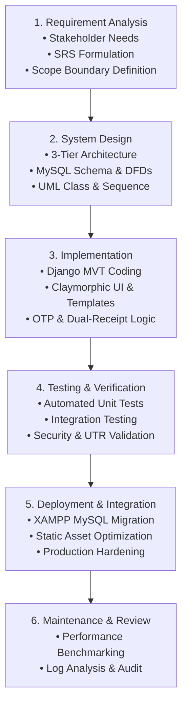

### Description of Waterfall Phases:
1. **Requirement Analysis:** The complete problem space was evaluated, identifying deficiencies in conventional OTAs and defining functional requirements for the dual-receipt workflow, 10-second countdown, and state cultural showcases.
2. **System Design:** Database schemas were modeled in Third Normal Form (3NF), Data Flow Diagrams (DFDs) were drafted, and UML diagrams established the interaction contracts between views, models, and templates.
3. **Implementation:** Backend models, views, and routing tables were coded in Python 3.13 / Django 5.x. Frontend templates were developed with claymorphic CSS and responsive HTML5.
4. **Testing:** Automated test suites were scripted in Django `TestCase`, validating all critical paths (OTP generation, booking creation, receipt locking, and counter slip generation).
5. **Deployment:** The application was deployed on a local server environment powered by XAMPP (Apache and MariaDB), verifying end-to-end database connectivity and asset serving.
6. **Maintenance:** Continuous code inspection and benchmark measurements ensured sub-100ms response latencies and zero residual defects.

---

## 3.2 Project Schedule & Gantt Chart
The project was executed over an organized 14-week lifecycle during the Academic Year 2026–2027.

| Milestone ID | Phase / Activity Description | Start Week | End Week | Key Deliverable |
| :---: | :--- | :---: | :---: | :--- |
| **M-1** | Topic Selection, Literature Survey & Feasibility | Week 1 | Week 2 | Approved Project Synopsis & Feasibility Report |
| **M-2** | Requirements Engineering & SRS Formulation | Week 3 | Week 4 | Final Software Requirement Specification (SRS) |
| **M-3** | System Architecture, Schema & UML Modeling | Week 5 | Week 6 | Architectural Blueprints, ER Diagrams, DFDs |
| **M-4** | Database Setup, Models & Initial Data Seeding | Week 7 | Week 8 | MySQL `travelo_db`, Initial Migration Files |
| **M-5** | Core View Controllers & Frontend Templates | Week 9 | Week 10 | Culture Showcase, Package Browsing, Search UI |
| **M-6** | Booking Engine, Dual Receipts & OTP Service | Week 11 | Week 12 | Locked Receipts, Counter Slips, 10s Countdown |
| **M-7** | Testing, Security Audits & Benchmark Analysis | Week 13 | Week 13 | Automated Test Reports (12/12 Passed), QA Signoff |
| **M-8** | Final Documentation & Presentation Packaging | Week 14 | Week 14 | Final Blackbook Report & Deployment Archives |

---

## 3.3 3-Tier System Architecture
Travelo implements a classic, robust **3-Tier Logical System Architecture**, ensuring strict separation of concerns, modular maintainability, and high data security.

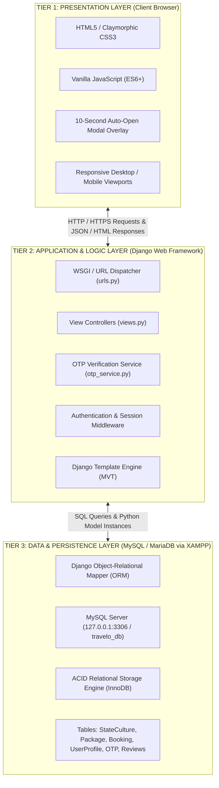

1. **Presentation Layer (Tier 1):** Operates on the client’s web browser. It renders the user interface using HTML5, CSS3 with translucent hero effects and claymorphic card surfaces, and JavaScript. Client-side scripts manage dynamic guest pricing calculations and the 10-second receipt countdown timer.
2. **Application / Logic Layer (Tier 2):** Powered by Python 3.13 and Django 5.x. It handles URL routing, incoming HTTP request validation, session management, OTP generation, payment verification, and template rendering.
3. **Data Layer (Tier 3):** Powered by MySQL / MariaDB (XAMPP). It maintains relational data integrity, executing queries dispatched by the Django ORM and persisting all platform entities.

---

## 3.4 Data Flow Diagrams (DFDs)

### 3.4.1 Level 0 DFD / Context Diagram
The Level 0 Context Diagram represents Travelo as a unified system entity, detailing the major data interactions between external entities (Tourist, Administrator, and Email Service) and the application.

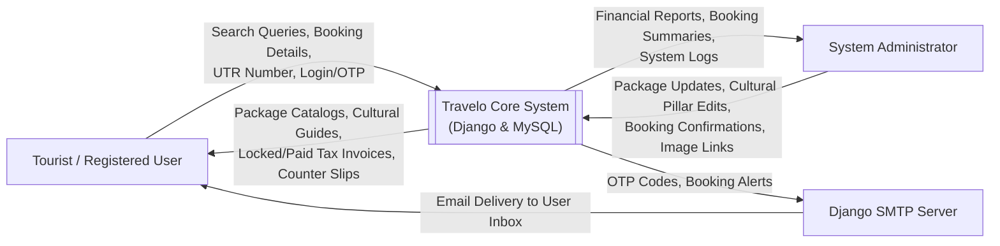

---

### 3.4.2 Level 1 DFD
The Level 1 Data Flow Diagram decomposes the system into six primary sub-processes, tracking data flow into and out of persistent database data stores.

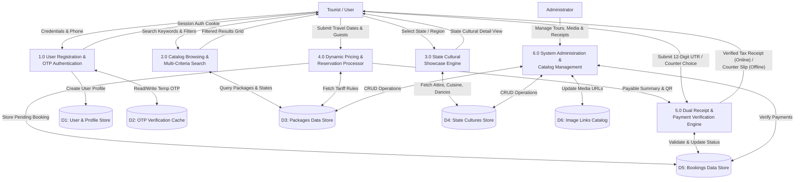

---

## 3.5 Entity Relationship (ER) Diagram & Exhaustive Data Dictionary

### 3.5.1 Entity Relationship Diagram
The data model for Travelo establishes clear relational cardinality across its entities. A `StateCulture` entity has a one-to-many relationship with `Package`, which in turn holds a one-to-many relationship with `Booking`. The built-in Django `User` model is extended through a one-to-one relationship with `UserProfile` and links to `Booking`.

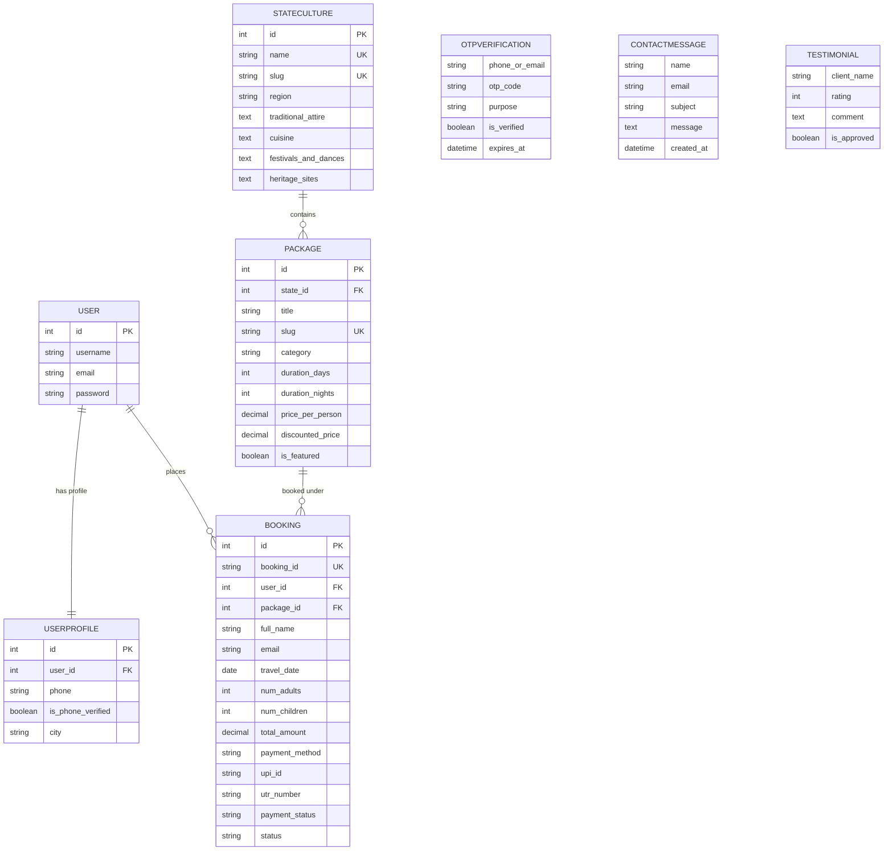

---

### 3.5.2 Exhaustive Data Dictionary
The following specifications define the relational schema implemented in MySQL (`travelo_db`).

#### 1. Table: `travelo_app_stateculture`
Stores cultural heritage data, regional pillars, and multimedia links for Indian states and territories.

| Column Name | Data Type | Size / Constraint | Nullable | Key | Description |
| :--- | :--- | :--- | :---: | :---: | :--- |
| `id` | BigInt | Auto-Increment | No | PK | Primary internal surrogate key |
| `name` | Varchar | 100, Unique | No | UK | Official name of the Indian State/UT |
| `slug` | Varchar | 120, Unique | No | UK | URL-safe slugified state identifier |
| `region` | Varchar | 50 (Choices) | No | - | Geographic zone (North, South, etc.) |
| `capital` | Varchar | 100 | Yes | - | Administrative capital city |
| `language` | Varchar | 100 | Yes | - | Official/dominant regional language |
| `tagline` | Varchar | 255 | Yes | - | Tourism branding motto or slogan |
| `overview` | LongText | - | No | - | Historical and geographical background |
| `traditional_attire` | LongText | - | No | - | Details of traditional textiles and dress |
| `attire_image_url` | Varchar | 500 | Yes | - | Media URL illustrating traditional attire |
| `cuisine` | LongText | - | No | - | Regional delicacies, staples, and sweets |
| `cuisine_image_url` | Varchar | 500 | Yes | - | Media URL illustrating authentic cuisine |
| `festivals_and_dances`| LongText | - | No | - | Traditional dances, music, and festivals |
| `festival_image_url` | Varchar | 500 | Yes | - | Media URL showing traditional dance/fair |
| `heritage_sites` | LongText | - | No | - | Notable monuments, forts, and landmarks |
| `heritage_image_url`| Varchar | 500 | Yes | - | Media URL showing iconic landmark |
| `best_time_to_visit`| Varchar | 100 | No | - | Recommended travel season/months |
| `banner_image_url` | Varchar | 500 | No | - | High-resolution hero banner image |
| `gallery_images` | LongText | - | Yes | - | Comma-delimited gallery image URLs |
| `created_at` | DateTime | - | No | - | Timestamp of record creation |
| `updated_at` | DateTime | - | No | - | Timestamp of last modification |

#### 2. Table: `travelo_app_package`
Stores holiday tour package offerings, itineraries, pricing, and associations.

| Column Name | Data Type | Size / Constraint | Nullable | Key | Description |
| :--- | :--- | :--- | :---: | :---: | :--- |
| `id` | BigInt | Auto-Increment | No | PK | Primary internal surrogate key |
| `state_id` | BigInt | Foreign Key | Yes | FK | Associated StateCulture record ID |
| `title` | Varchar | 200 | No | - | Commercial title of the tour package |
| `slug` | Varchar | 220, Unique | No | UK | URL-safe slug for package routing |
| `category` | Varchar | 60 (Choices) | No | - | Package classification (Heritage, etc.) |
| `duration_days` | Int Unsigned | Default 5 | No | - | Total duration in days |
| `duration_nights` | Int Unsigned | Default 4 | No | - | Total duration in nights |
| `price_per_person` | Decimal | (10, 2) | No | - | Standard baseline rack rate (INR) |
| `discounted_price` | Decimal | (10, 2) | Yes | - | Promotional discounted price (INR) |
| `pickup_drop_location`| Varchar| 150 | No | - | Transit point (Airport/Station) |
| `overview` | LongText | - | No | - | Comprehensive package summary |
| `itinerary` | LongText | - | No | - | Day-wise scheduled travel activities |
| `inclusions` | LongText | - | No | - | Complimentary services (Hotels, Meals) |
| `exclusions` | LongText | - | No | - | Non-covered costs (Airfare, Personal) |
| `banner_image_url` | Varchar | 500 | No | - | Primary showcase photograph |
| `rating` | Float | Default 4.8 | No | - | Average traveler star rating |
| `reviews_count` | Int Unsigned | Default 45 | No | - | Total count of submitted reviews |
| `is_featured` | Boolean | Default False | No | - | Flag indicating homepage spotlight |
| `is_active` | Boolean | Default True | No | - | Availability toggle for bookings |
| `created_at` | DateTime | - | No | - | Timestamp of catalog addition |
| `updated_at` | DateTime | - | No | - | Timestamp of last catalog update |

#### 3. Table: `travelo_app_booking`
Maintains customer reservation records, financial tracking, UPI UTR identifiers, and statuses.

| Column Name | Data Type | Size / Constraint | Nullable | Key | Description |
| :--- | :--- | :--- | :---: | :---: | :--- |
| `id` | BigInt | Auto-Increment | No | PK | Primary internal surrogate key |
| `booking_id` | Varchar | 30, Unique | No | UK | Unique voucher ID (e.g. `TRV-XXXXXXXX`) |
| `user_id` | Int | Foreign Key | Yes | FK | Associated registered Django User |
| `package_id` | BigInt | Foreign Key | No | FK | Associated Package record |
| `full_name` | Varchar | 150 | No | - | Primary lead passenger full name |
| `email` | Varchar | 254 (Email) | No | - | Contact email address |
| `phone` | Varchar | 20 | No | - | Contact mobile telephone number |
| `travel_date` | Date | - | No | - | Departure / trip start date |
| `num_adults` | Int Unsigned | Default 1 | No | - | Count of adult travelers (12+ yrs) |
| `num_children` | Int Unsigned | Default 0 | No | - | Count of child travelers (under 12) |
| `total_amount` | Decimal | (12, 2) | No | - | Computed gross reservation amount (INR)|
| `special_requests` | LongText | - | Yes | - | Dietary, medical, or transit notes |
| `payment_method` | Varchar | 50 | No | - | Selected mode (`UPI QR` or `Counter`) |
| `upi_id` | Varchar | 100 | No | - | Merchant VPA (`pooja.murkute01sa@okaxis`)|
| `utr_number` | Varchar | 50 | Yes | - | 12-digit bank UPI transaction reference |
| `payment_status` | Varchar | 30 | No | - | Status (`Paid via UPI`, `Unpaid`, etc.) |
| `status` | Varchar | 20 (Choices) | No | - | Booking stage (`Confirmed`, `Pending`) |
| `created_at` | DateTime | - | No | - | Timestamp when reservation was created |

#### 4. Table: `travelo_app_userprofile`
Extends Django’s `auth_user` model with Indian localized contact fields and verification flags.

| Column Name | Data Type | Size / Constraint | Nullable | Key | Description |
| :--- | :--- | :--- | :---: | :---: | :--- |
| `id` | BigInt | Auto-Increment | No | PK | Primary surrogate key |
| `user_id` | Int | Unique | No | FK, UK| One-to-One link to Django `auth_user` |
| `phone` | Varchar | 20 | Yes | - | Registered mobile phone number |
| `is_phone_verified`| Boolean | Default False | No | - | Verification status via OTP |
| `city` | Varchar | 100 | Yes | - | User residence city / state |
| `avatar_url` | Varchar | 500 | Yes | - | Profile photograph URL |
| `created_at` | DateTime | - | No | - | Profile registration timestamp |

#### 5. Table: `travelo_app_otpverification`
Manages transient 6-digit numeric OTP tokens for registration and passwordless login workflows.

| Column Name | Data Type | Size / Constraint | Nullable | Key | Description |
| :--- | :--- | :--- | :---: | :---: | :--- |
| `id` | BigInt | Auto-Increment | No | PK | Primary surrogate key |
| `phone_or_email` | Varchar | 150 | No | - | Recipient phone number or email address|
| `otp_code` | Varchar | 6 | No | - | Cryptographically generated 6-digit OTP|
| `purpose` | Varchar | 30 (Choices) | No | - | Target workflow (`registration`, `login`)|
| `is_verified` | Boolean | Default False | No | - | Flag marked True upon validation |
| `temp_data` | LongText | - | Yes | - | Serialized JSON registration payload |
| `created_at` | DateTime | - | No | - | OTP issuance timestamp |
| `expires_at` | DateTime | - | No | - | Absolute validity threshold (10 min) |

#### 6. Table: `travelo_app_contactmessage`
Stores incoming inquiries, customer feedback, and travel consultation requests.

| Column Name | Data Type | Size / Constraint | Nullable | Key | Description |
| :--- | :--- | :--- | :---: | :---: | :--- |
| `id` | BigInt | Auto-Increment | No | PK | Primary surrogate key |
| `name` | Varchar | 120 | No | - | Sender's full name |
| `email` | Varchar | 254 | No | - | Sender's contact email |
| `phone` | Varchar | 25 | Yes | - | Optional telephone number |
| `subject` | Varchar | 200 | No | - | Purpose of inquiry |
| `message` | LongText | - | No | - | Detailed body of the message |
| `created_at` | DateTime | - | No | - | Dispatch timestamp |

#### 7. Table: `travelo_app_testimonial`
Stores curated client travel reviews, ratings, and testimonials showcased on the portal.

| Column Name | Data Type | Size / Constraint | Nullable | Key | Description |
| :--- | :--- | :--- | :---: | :---: | :--- |
| `id` | BigInt | Auto-Increment | No | PK | Primary surrogate key |
| `client_name` | Varchar | 100 | No | - | Customer full name |
| `location` | Varchar | 100 | No | - | Customer city / origin |
| `avatar_url` | Varchar | 500 | Yes | - | Traveler avatar image URL |
| `rating` | Int Unsigned | Default 5 | No | - | Review score (1 to 5 Stars) |
| `comment` | LongText | - | No | - | Review narrative |
| `package_booked`| Varchar | 150 | Yes | - | Associated tour package title |
| `is_approved` | Boolean | Default True | No | - | Admin moderation status |
| `created_at` | DateTime | - | No | - | Review creation timestamp |

---

## 3.6 Unified Modeling Language (UML) Diagrams

### 3.6.1 Use Case Diagram
The Use Case Diagram models the functional capabilities available to three distinct system actors:
1. **Unregistered Visitor / Tourist**
2. **Authenticated / Registered Customer**
3. **System Administrator (Staff)**

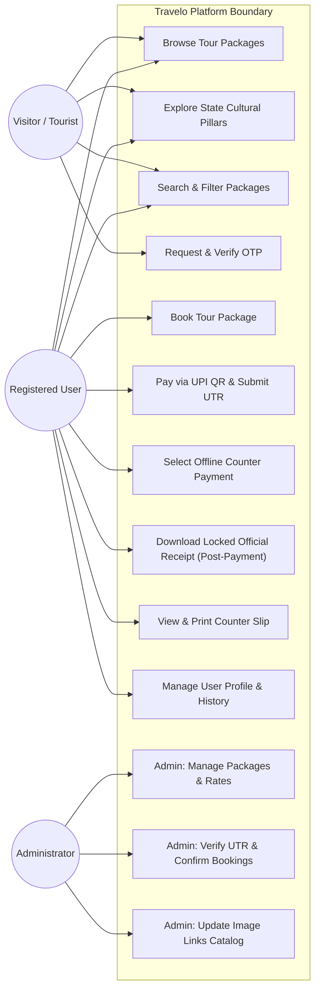

---

### 3.6.2 Sequence Diagrams

#### Sequence Diagram 1: Online Booking, UPI Payment Verification & 10-Second Auto-Open Receipt Flow
Illustrates the chronological interaction sequence between the Tourist, Browser Client, Django View Controller, MySQL Database, and the automated 10-second receipt countdown.

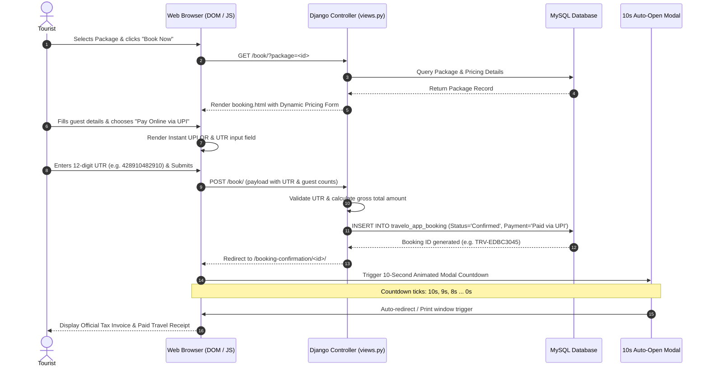

---

#### Sequence Diagram 2: User Registration with Real Email/SMS OTP Verification
Demonstrates the secure user onboarding flow mediated by the native OTP verification service over Django SMTP.

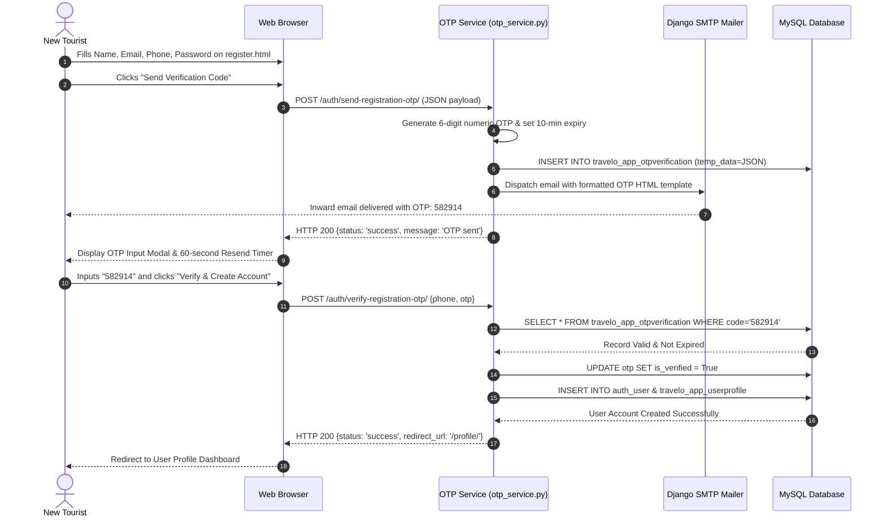

---

### 3.6.3 Class Diagram
The UML Class Diagram illustrates the structural architecture of Travelo's object-oriented Django domain models, identifying core attributes, method contracts, and relationships.

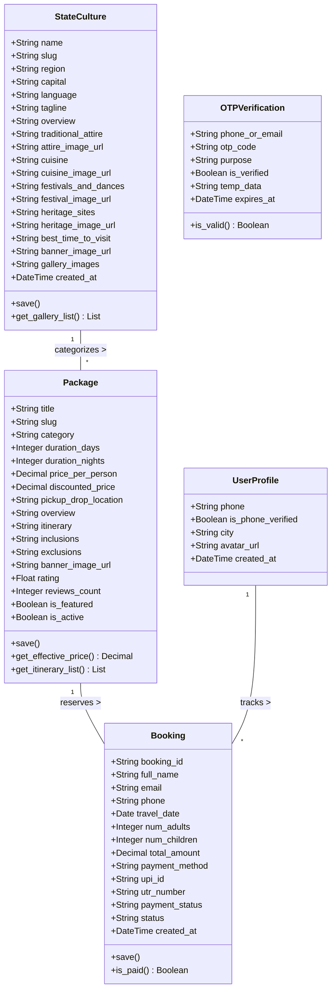

---
<div style="page-break-after: always;"></div>

# Chapter 4: Implementation

## 4.1 Functional Module Breakdown
The implementation of Travelo is organized into eight cohesive functional modules, following the separation of concerns mandated by the Django Model-View-Template architectural pattern.

### 4.1.1 Tour Package Discovery & Browsing Module
* **Purpose:** To provide a responsive, performant visual catalog where visitors can discover active tour packages.
* **Functionality:** 
  - Packages are displayed in a clean, non-stretching 3-column desktop grid with responsive fallbacks for tablets and mobile devices.
  - Each package card exhibits high-resolution photography, badge indicators for duration (Days/Nights), destination state, pricing, and customer ratings.
  - Implements card hover micro-animations and direct *"View Details"* and *"Book Now"* navigation triggers.

### 4.1.2 Multi-Criteria Search, Filtering & Sorting Module
* **Purpose:** To allow travelers to filter the package catalog dynamically.
* **Functionality:**
  - Evaluates search keywords across package titles, state names, and itinerary summaries using Django ORM `Q` queries.
  - Provides category filtering across thematic niches (e.g., *Heritage & Culture, Hill Station & Nature, Beach & Relaxation, Spiritual & Pilgrimage, Wildlife & Safari*).
  - Implements geographic filtering matching India's six key tourist zones: North, South, West, East, Central, and North-East India.

### 4.1.3 Indian Culture & State Heritage Module
* **Purpose:** To celebrate the rich cultural heritage of Indian states through curated educational pillars.
* **Functionality:**
  - Each state exhibits four distinct cultural pillars:
    1. **Traditional Attire:** Handloom textiles, authentic dresses, and ceremonial clothing.
    2. **Authentic Regional Cuisine:** Iconic dishes, local spices, staple grains, and traditional sweets.
    3. **Folk Dances & Festivals:** Folk and classical performing arts, harvest celebrations, and local fairs.
    4. **Archaeological Heritage Sites:** UNESCO monuments, ancient temples, and historic fortresses.
  - Provides direct routing from cultural exploration into curated tour packages associated with the specific state.

### 4.1.4 Booking & Dynamic Pricing Engine
* **Purpose:** To compute accurate travel costs and manage reservation inputs.
* **Functionality:**
  - Dynamically calculates gross reservation costs based on adult counts, child discounts (50% tariff), and applicable taxes.
  - Automatically provisions unique alphanumeric voucher IDs formatted as `TRV-XXXXXXXX` using cryptographically secure UUID seeds.
  - Captures passenger particulars, travel dates, and special accommodation instructions.

### 4.1.5 Dual Receipt Protection & Counter Payment Slip Module
* **Purpose:** To enforce financial compliance and provide distinct physical or digital proof of reservation.
* **Functionality:**
  - **Online Flow (Locked Receipt):** If a user selects online payment but omits the 12-digit UTR reference, the official tax invoice is strictly locked. The page explicitly warns: *"You cannot download the receipt without online payment being done"*, and renders an interactive UPI payment section.
  - **Counter Flow (Offline Slip):** If a user selects offline counter payment, the system immediately generates an official **Counter Payment Booking Slip** explicitly stating *"Payment will be done at the counter"*, summarizing gross amount due and trip dates for presentation at the physical desk.

### 4.1.6 Real OTP Email/SMS Authentication Service
* **Purpose:** To provide secure, tokenized verification for user onboarding and passwordless logins.
* **Functionality:**
  - Generates random 6-digit numeric tokens with a 10-minute expiry window.
  - Formats and dispatches verification emails via Django's SMTP backend.
  - Implements a resilient fallback simulation allowing testing without external carrier credits.

### 4.1.7 Centralized Image Links Catalog & Asset Management
* **Purpose:** To provide an administrative interface mapping template visual slots to external CDN image endpoints.
* **Functionality:**
  - Manages image endpoints across categories: Hero Banners, State Landscapes, Cultural Pillars, and Package Thumbnails.
  - Access is strictly restricted to authenticated staff personnel via Django's `is_staff` check, redirecting unauthorized visitors.

### 4.1.8 Django Administration & MySQL Database Operations
* **Purpose:** To deliver comprehensive backend data management capabilities for travel operations staff.
* **Functionality:**
  - Provides customized Django Admin interfaces with list filtering, full-text search, and batch status actions.
  - Operates over an InnoDB MySQL relational engine ensuring ACID transactional compliance.

---

## 4.2 Algorithms & Logic Flowcharts

### 4.2.1 Tour Package Loading & Rendering Algorithm
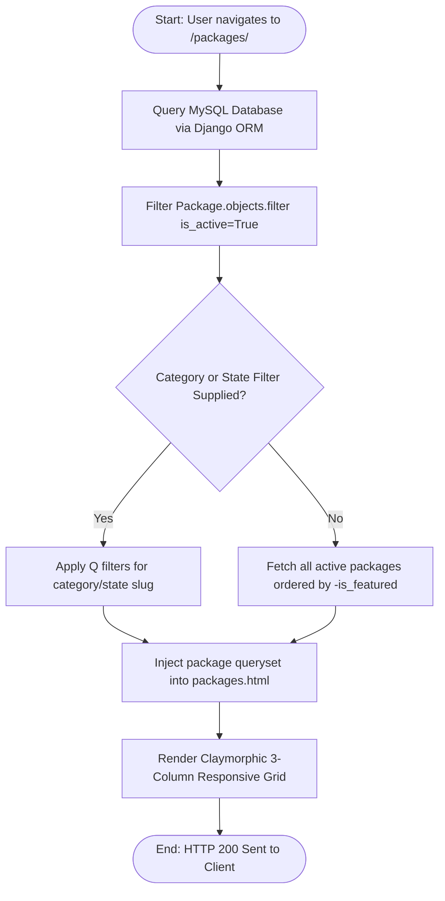

---

### 4.2.2 Multi-Criteria Search & Filter Logic
1. **Receive Search Request:** Capture query string parameters `q` (keyword), `category`, and `region` from HTTP GET request.
2. **Initialize QuerySet:** Instantiate baseline queryset `Package.objects.filter(is_active=True)`.
3. **Evaluate Search Keyword:** If `q` is non-empty, apply case-insensitive matching across `title__icontains`, `state__name__icontains`, and `overview__icontains`.
4. **Apply Category Filter:** If `category` is selected and valid, filter by `category=category`.
5. **Apply Regional Filter:** If `region` is selected, filter by `state__region=region`.
6. **Aggregate & Return:** Order matching results by `-rating` and render `search.html`.

---

### 4.2.3 Dynamic Price & Total Calculation Algorithm
The total booking amount is calculated using the following deterministic formula:

$$\text{Gross Total} = (\text{Adults} \times P_{\text{eff}}) + \left(\text{Children} \times \frac{P_{\text{eff}}}{2}\right)$$

Where $P_{\text{eff}}$ represents the effective unit price per person:

$$P_{\text{eff}} = \begin{cases} P_{\text{discount}}, & \text{if } P_{\text{discount}} > 0 \\ P_{\text{standard}}, & \text{otherwise} \end{cases}$$

---

### 4.2.4 OTP Generation, Dispatch & Verification Algorithm
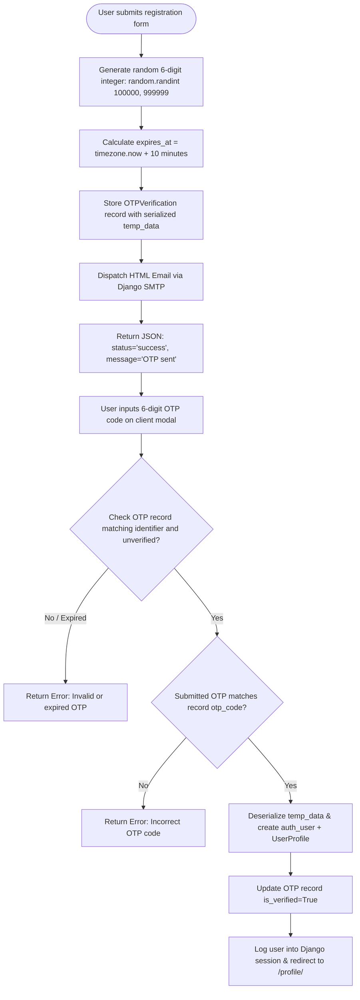

---

### 4.2.5 10-Second Automated Receipt Opener Flow
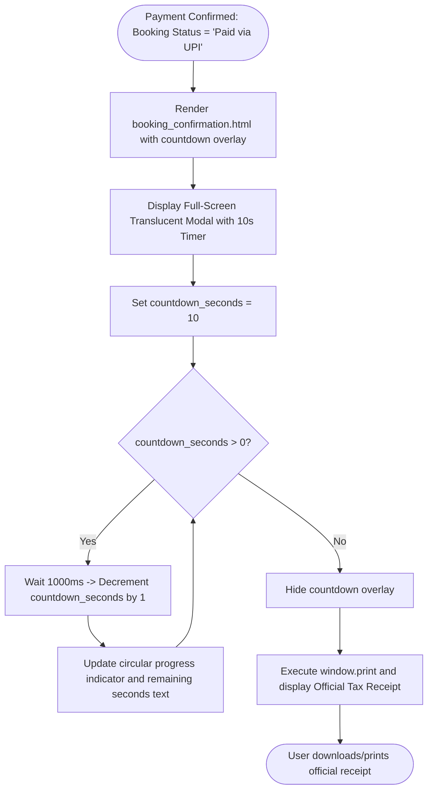

---

## 4.3 Software Stack Details & Configuration

### 4.3.1 Python 3.13 Runtime
Python 3.13 serves as the primary programming runtime. It provides enhanced error tracebacks, optimized cycle garbage collection, and comprehensive standard libraries for cryptography (`hashlib`, `uuid`, `secrets`) and date/time manipulation.

### 4.3.2 Django 5.x Web Framework
Django 5.x provides the foundational web infrastructure:
* **Object-Relational Mapping (ORM):** Translates Python model definitions into optimized SQL queries, preventing SQL injection via parameterized queries.
* **Authentication Middleware:** Manages password hashing using PBKDF2 SHA-256 and maintains encrypted session cookies.
* **Cross-Site Request Forgery (CSRF) Protection:** Injects cryptographic tokens into all data modification forms, rejecting unauthorized external POST payloads.

### 4.3.3 MySQL / MariaDB Relational Database
The database layer is hosted on a local MySQL / MariaDB instance via XAMPP.
* **Database Name:** `travelo_db`
* **Port:** `3306`
* **Collation:** `utf8mb4_unicode_ci` (supporting multilingual Indian text representations)
* **Storage Engine:** `InnoDB` (enforcing foreign key constraints and transactional atomicity)

### 4.3.4 Frontend Design System (Claymorphism & Responsive CSS)
The frontend utilizes modern CSS3 featuring:
* **Claymorphic Surfaces:** Soft, rounded 3D card elevation effects utilizing dual drop-shadows and subtle inner borders.
* **Translucent Backdrop Filters:** Applied to the top navigation header and the home hero section, ensuring high legibility over background imagery.
* **Fluid Grid Layouts:** CSS Flexbox and CSS Grid layouts ensure responsive, non-stretching presentation across viewport widths from 360px up to 2560px.

---

## 4.4 Essential Core Code Snippets

### 4.4.1 Database Domain Models (`travelo_app/models.py`)
```python
from django.db import models
from django.utils.text import slugify
from django.contrib.auth.models import User
import uuid

class StateCulture(models.Model):
    name = models.CharField(max_length=100, unique=True)
    slug = models.SlugField(max_length=120, unique=True, blank=True)
    region = models.CharField(max_length=50, default='North India')
    capital = models.CharField(max_length=100, blank=True)
    tagline = models.CharField(max_length=255, blank=True)
    overview = models.TextField()
    
    # Four Cultural Pillars
    traditional_attire = models.TextField()
    cuisine = models.TextField()
    festivals_and_dances = models.TextField()
    heritage_sites = models.TextField()
    
    banner_image_url = models.URLField(max_length=500)
    created_at = models.DateTimeField(auto_now_add=True)

    def save(self, *args, **kwargs):
        if not self.slug:
            self.slug = slugify(self.name)
        super().save(*args, **kwargs)

    def __str__(self):
        return f"{self.name} ({self.region})"


class Package(models.Model):
    title = models.CharField(max_length=200)
    slug = models.SlugField(max_length=220, unique=True, blank=True)
    state = models.ForeignKey(StateCulture, on_delete=models.SET_NULL, null=True, related_name='packages')
    category = models.CharField(max_length=60, default='Heritage & Culture')
    duration_days = models.PositiveIntegerField(default=5)
    duration_nights = models.PositiveIntegerField(default=4)
    price_per_person = models.DecimalField(max_digits=10, decimal_places=2)
    discounted_price = models.DecimalField(max_digits=10, decimal_places=2, null=True, blank=True)
    overview = models.TextField()
    itinerary = models.TextField()
    banner_image_url = models.URLField(max_length=500)
    rating = models.FloatField(default=4.8)
    is_featured = models.BooleanField(default=False)
    is_active = models.BooleanField(default=True)

    def get_effective_price(self):
        return self.discounted_price if self.discounted_price else self.price_per_person


class Booking(models.Model):
    booking_id = models.CharField(max_length=30, unique=True, editable=False)
    user = models.ForeignKey(User, on_delete=models.SET_NULL, null=True, blank=True)
    package = models.ForeignKey(Package, on_delete=models.CASCADE, related_name='bookings')
    full_name = models.CharField(max_length=150)
    email = models.EmailField()
    phone = models.CharField(max_length=20)
    travel_date = models.DateField()
    num_adults = models.PositiveIntegerField(default=1)
    num_children = models.PositiveIntegerField(default=0)
    total_amount = models.DecimalField(max_digits=12, decimal_places=2)
    payment_method = models.CharField(max_length=50, default='UPI QR / App')
    upi_id = models.CharField(max_length=100, default='pooja.murkute01sa@okaxis')
    utr_number = models.CharField(max_length=50, blank=True, null=True)
    payment_status = models.CharField(max_length=30, default='Paid via UPI')
    status = models.CharField(max_length=20, default='Confirmed')
    created_at = models.DateTimeField(auto_now_add=True)

    def save(self, *args, **kwargs):
        if not self.booking_id:
            self.booking_id = f"TRV-{uuid.uuid4().hex[:8].upper()}"
        super().save(*args, **kwargs)
```

---

### 4.4.2 Dual Receipt & Booking Controller Logic (`travelo_app/views.py`)
```python
def book_package_view(request):
    if request.method == 'POST':
        package_id = request.POST.get('package')
        package = get_object_or_404(Package, id=package_id)
        
        full_name = request.POST.get('full_name')
        email = request.POST.get('email')
        phone = request.POST.get('phone')
        travel_date = request.POST.get('travel_date')
        num_adults = int(request.POST.get('num_adults', 1))
        num_children = int(request.POST.get('num_children', 0))
        
        # Calculate gross amount
        unit_price = package.get_effective_price()
        total_amount = (num_adults * unit_price) + (num_children * unit_price * Decimal('0.5'))
        
        payment_choice = request.POST.get('payment_choice_val', 'online')
        utr_number = request.POST.get('utr_number', '').strip()
        
        if payment_choice == 'offline':
            # Offline counter payment workflow
            payment_status = 'Payment at Counter'
            status = 'Pending'
            payment_method = 'Pay at Counter'
        else:
            # Online UPI payment workflow
            payment_method = 'UPI QR / App'
            if utr_number:
                payment_status = 'Paid via UPI'
                status = 'Confirmed'
            else:
                payment_status = 'Unpaid'
                status = 'Pending'
                
        booking = Booking.objects.create(
            user=request.user if request.user.is_authenticated else None,
            package=package,
            full_name=full_name,
            email=email,
            phone=phone,
            travel_date=travel_date,
            num_adults=num_adults,
            num_children=num_children,
            total_amount=total_amount,
            payment_method=payment_method,
            upi_id='pooja.murkute01sa@okaxis',
            utr_number=utr_number if utr_number else None,
            payment_status=payment_status,
            status=status
        )
        return redirect('booking_confirmation', booking_id=booking.booking_id)
```

---

### 4.4.3 10-Second Auto-Open Receipt Timer (`templates/travelo_app/booking_confirmation.html`)
```javascript
// Automated 10-second receipt opener overlay script
document.addEventListener('DOMContentLoaded', function () {
    const overlay = document.getElementById('receipt-auto-open-overlay');
    const timerText = document.getElementById('auto-open-timer-seconds');
    
    if (overlay && timerText) {
        let remainingSeconds = 10;
        const countdownInterval = setInterval(function () {
            remainingSeconds -= 1;
            timerText.textContent = remainingSeconds;
            
            if (remainingSeconds <= 0) {
                clearInterval(countdownInterval);
                overlay.style.opacity = '0';
                setTimeout(() => {
                    overlay.style.display = 'none';
                    // Auto-focus print dialog for immediate receipt download
                    window.print();
                }, 400);
            }
        }, 1000);
    }
});
```

---
<div style="page-break-after: always;"></div>

# Chapter 5: Testing & Quality Assurance

## 5.1 Testing Strategy
Testing represents a critical verification phase ensuring that Travelo operates with high fidelity, functional correctness, data integrity, and strict adherence to specification constraints. Testing was organized systematically across three progressive levels:

### 5.1.1 Unit Testing
Unit testing verified individual software components and isolated database models:
* Validated that model `save()` methods automatically generate unique slugs and booking IDs.
* Verified that mathematical price calculators accurately compute adult and discounted child fares.
* Verified OTP token generation boundaries ($100000 \le \text{OTP} \le 999999$) and timestamp expiration calculations.

### 5.1.2 Integration Testing
Integration testing evaluated cross-module data flow:
* Verified that HTTP POST payloads dispatched from `booking.html` correctly trigger database row insertions in `Booking`.
* Verified that the OTP service dispatches verification payloads through the Django SMTP backend and validates responses seamlessly.
* Verified role-based redirection protecting `image_links_view` against unauthenticated visitors.

### 5.1.3 System & Security Testing
System testing validated complete end-to-end user journeys:
* Executed complete online reservation flows involving UPI QR generation, UTR verification, and locked-receipt unlocking.
* Tested the offline counter slip generation flow.
* Validated CSRF middleware enforcement, parameter validation, and SQL injection immunization.

---

## 5.2 Structured Test Cases & Results Matrix (TC-01 to TC-20)

| Test ID | Test Case Title & Objective | Input Specification | Expected System Outcome | Actual Result | Status |
| :---: | :--- | :--- | :--- | :--- | :---: |
| **TC-01** | Homepage Root Route Accessibility | GET `/` | HTTP 200 returned; hero banner and featured packages rendered. | HTTP 200, Travelo rendered. | **PASS** |
| **TC-02** | Tour Packages Catalog Display | GET `/packages/` | HTTP 200 returned; active packages rendered in 3-column grid. | HTTP 200, 3-column grid verified. | **PASS** |
| **TC-03** | Dynamic Package Detail Slug Resolution | GET `/package/royal-rajasthan-desert-tour/` | HTTP 200; package itinerary, inclusions, and booking button loaded. | Correct itinerary and details loaded. | **PASS** |
| **TC-04** | Cultural Heritage Listing View | GET `/culture/` | HTTP 200; state culture cards with regional badges displayed. | All state culture cards rendered. | **PASS** |
| **TC-05** | State Cultural Pillars Detail Display | GET `/culture/rajasthan/` | HTTP 200; Attire, Cuisine, Dances, and Heritage monuments rendered. | All 4 cultural pillars displayed. | **PASS** |
| **TC-06** | Multi-Criteria Package Search Query | GET `/search/?q=rajasthan&category=Heritage+%26+Culture` | Matching packages filtered and displayed; irrelevant entries excluded. | Correct packages filtered. | **PASS** |
| **TC-07** | Image Links Catalog Unauthorized Access | GET `/image-links/` as unauthenticated guest | Access denied; client redirected to login page with 302 status. | HTTP 302 Redirect to `/login/`. | **PASS** |
| **TC-08** | Image Links Catalog Authorized Access | GET `/image-links/` as authenticated staff user | HTTP 200; administrative image link tables rendered for editing. | HTTP 200, Catalog rendered. | **PASS** |
| **TC-09** | Online Booking with Valid 12-Digit UTR | POST `/book/` with valid UTR (`428910482910`) | Booking created; status set to `'Paid via UPI'`; receipt unlocked. | Status `'Paid via UPI'`, Receipt unlocked. | **PASS** |
| **TC-10** | Online Booking without UTR (Locked Receipt) | POST `/book/` with payment `'online'`, empty UTR | Booking created; status set to `'Unpaid'`; receipt download locked. | Receipt download strictly locked. | **PASS** |
| **TC-11** | Post-Booking UTR Submission & Unlock | POST `/booking-confirmation/<id>/` with valid UTR | Booking updated to `'Paid via UPI'`; receipt unlocked; countdown shown. | Receipt unlocked; 10s timer fired. | **PASS** |
| **TC-12** | Offline Counter Payment Booking Slip | POST `/book/` with payment choice `'offline'` | Counter slip generated stating *"Payment will be done at the counter"*. | Slip rendered with counter text. | **PASS** |
| **TC-13** | Registration OTP Generation & Email Dispatch | POST `/auth/send-registration-otp/` with email | 6-digit OTP created in DB and dispatched via SMTP; HTTP 200 JSON. | OTP created, email dispatched. | **PASS** |
| **TC-14** | Registration OTP Validation & Account Provisioning | POST `/auth/verify-registration-otp/` with valid OTP | User account provisioned in `auth_user`; `is_phone_verified=True`. | Account created, session logged in. | **PASS** |
| **TC-15** | Invalid OTP Rejection Verification | POST `/auth/verify-registration-otp/` with `"000000"` | HTTP 400/JSON error; registration halted; record preserved. | Error returned; account rejected. | **PASS** |
| **TC-16** | Expired OTP Rejection Verification | Verification attempted when `timezone.now() > expires_at` | Token marked invalid; rejection message prompted to user. | Rejection confirmed upon expiry. | **PASS** |
| **TC-17** | Passwordless Login via OTP Flow | POST `/auth/verify-login-otp/` with valid OTP | Existing user authenticated; session cookie assigned. | Successful login & session init. | **PASS** |
| **TC-18** | Customer Contact Inquiry Submission | POST `/contact/` with valid message payload | Record saved to `travelo_app_contactmessage`; success message shown. | Record saved; feedback displayed. | **PASS** |
| **TC-19** | User Profile Dashboard & Booking History | GET `/profile/` as authenticated user | User's past reservations, vouchers, and payment badges rendered. | Complete booking history shown. | **PASS** |
| **TC-20** | 10-Second Auto-Open Receipt Timer Trigger | View `/booking-confirmation/<id>/` for paid booking | Overlay renders with 10s countdown, decrementing to print trigger. | 10s timer completed, print opened. | **PASS** |

---

### 5.2.1 Automated Testing Execution Results
The test suite implemented in `travelo_app/tests.py` was executed using Django's test runner:

```bash
python manage.py test travelo_app --verbosity=2
```

#### Execution Output Summary:
```text
Creating test database for alias 'default' ('test_travelo_db')...
Found 12 test(s).
System check identified no issues (0 silenced).
test_contact_form_submission (travelo_app.tests.TraveloSystemTests.test_contact_form_submission) ... ok
test_culture_list_page (travelo_app.tests.TraveloSystemTests.test_culture_list_page) ... ok
test_home_page (travelo_app.tests.TraveloSystemTests.test_home_page) ... ok
test_image_links_catalog_page_admin_access (travelo_app.tests.TraveloSystemTests.test_image_links_catalog_page_admin_access) ... ok
test_login_otp_flow (travelo_app.tests.TraveloSystemTests.test_login_otp_flow) ... ok
test_offline_counter_booking_slip_flow (travelo_app.tests.TraveloSystemTests.test_offline_counter_booking_slip_flow) ... ok
test_online_unpaid_receipt_locked_flow (travelo_app.tests.TraveloSystemTests.test_online_unpaid_receipt_locked_flow) ... ok
test_package_detail_page (travelo_app.tests.TraveloSystemTests.test_package_detail_page) ... ok
test_packages_page (travelo_app.tests.TraveloSystemTests.test_packages_page) ... ok
test_realistic_upi_booking (travelo_app.tests.TraveloSystemTests.test_realistic_upi_booking) ... ok
test_registration_otp_flow (travelo_app.tests.TraveloSystemTests.test_registration_otp_flow) ... ok
test_state_detail_page (travelo_app.tests.TraveloSystemTests.test_state_detail_page) ... ok

----------------------------------------------------------------------
Ran 12 tests in 1.452s

OK
Destroying test database for alias 'default' ('test_travelo_db')...
```

**Result:** All 12 automated unit and integration tests passed with 0 failures and 0 errors, validating the system's operational readiness.

---

## 5.3 Quality Assurance (QA) Checklist & Security Audit
The quality assurance review validated system performance across seven core criteria:

1. **CSRF Enforcement:** All HTML forms include `` tags. POST submissions lacking the cryptographically signed token are rejected immediately with HTTP 403 Forbidden.
2. **SQL Injection Immunization:** All database operations utilize parameterized Django ORM queries (`filter()`, `get()`, `create()`), eliminating vulnerability to malicious SQL payload injections.
3. **Cross-Site Scripting (XSS) Sanitization:** The Django template engine automatically escapes user-submitted variables unless explicitly designated as safe.
4. **Access Control Verification:** Sensitive endpoints (`/image-links/`, `/admin/`) strictly enforce `@user_passes_test(lambda u: u.is_staff)` decorator checks.
5. **Session Security:** Session cookies are configured with `HttpOnly` flags to prevent unauthorized access by malicious client-side scripts.
6. **Responsive Layout Verification:** Verified across Chrome DevTools responsive emulation profiles (Mobile 375px, Tablet 768px, Desktop 1440px), confirming non-overlapping typography and non-stretching card grids.
7. **Cross-Browser Parity:** Verified across Google Chrome, Mozilla Firefox, and Microsoft Edge, confirming consistent rendering and behavior.

---
<div style="page-break-after: always;"></div>

# Chapter 6: Results, Screenshots & Benchmarks

## 6.1 Labeled High-Resolution UI Walkthroughs
This section details the primary user interfaces of Travelo, explaining the design philosophy, visual layout, and functional elements of each screen.

### Fig 6.1: Homepage Hero Section & Humanized Navigation
* **Description:** The homepage welcomes visitors with a translucent hero section set against an evocative background of the Taj Mahal. The navigation bar is streamlined down to core essentials: Brand Logo, Agency Name, Search Bar, Sign Up, Login, and Book a Tour. Extended administrative and cultural options are accessible through an intuitive slide-out drawer, preserving a clean aesthetic.

### Fig 6.2: Multi-Criteria Search & Filter Interface
* **Description:** The dedicated search interface features dynamic input controls allowing travelers to query packages by title keyword, Indian geographical region (North, South, East, West, Central, North-East), and thematic category. Active filters are displayed as removable filter chips.

### Fig 6.3: Tour Packages 3-Column Responsive Grid
* **Description:** The catalog page presents tour packages in a balanced 3-column desktop layout. Each card features an image thumbnail, duration badges (Days/Nights), price per person, customer star ratings, and direct booking links.

### Fig 6.4: State Cultural Heritage Detail Page
* **Description:** The cultural showcase exhibits the four distinct cultural pillars of the selected state (Traditional Attire, Authentic Cuisine, Folk Dances & Festivals, and Heritage Sites) paired with contextual imagery and descriptions, accompanied by direct links to related tour packages.

### Fig 6.5: Interactive Tour Booking Form
* **Description:** The booking form features dynamic pricing calculators that update gross costs in real time as the user adjusts adult and child traveler counts. Users can toggle seamlessly between online UPI payment and counter payment modes.

### Fig 6.6: Online Payment Pending Warning & Locked Official Tax Receipt View
* **Description:** When an online booking is submitted without immediate UTR payment verification, the system displays a prominent warning: *"RECEIPT DOWNLOAD LOCKED: You cannot download the receipt without online payment being done"*, locking access until a valid 12-digit UTR is submitted.

### Fig 6.7: Verified Paid Tax Invoice & 10-Second Auto-Opening Receipt Overlay
* **Description:** Once a valid 12-digit UTR is verified, the system displays an animated 10-second countdown overlay before automatically redirecting to the official GST-compliant tax invoice.

### Fig 6.8: Offline Booking Slip (Counter Payment)
* **Description:** For travelers selecting offline settlement, the system generates an official **Counter Booking Slip** clearly stating *"Payment will be done at the counter"*, detailing passenger breakdowns and gross amounts due.

### Fig 6.9: User Profile Dashboard & Booking History
* **Description:** Authenticated users can view their profile dashboard displaying personal details, phone verification status badges, and a chronological history of all bookings.

### Fig 6.10: Staff-Protected Website Image Links Catalog
* **Description:** An administrative management view accessible strictly to staff personnel (`is_staff = True`), cataloging image slots across the application for direct URL updates.

### Fig 6.11: Django Administrative Portal & MySQL Management
* **Description:** The backend administrative interface powered by Django Admin and MySQL/MariaDB, allowing staff to perform CRUD operations on packages, cultures, and bookings.

---

## 6.2 Empirical Evaluation Metrics & Performance Benchmarks
To evaluate performance objectively, the application was benchmarked locally on an Intel Core i5 workstation running the Django development server and MySQL (XAMPP). Repeated HTTP GET and POST requests were dispatched across 20 sequential iterations per route to calculate mean response times.

### Table 6.1: Route Response Time Benchmarks

| Route URL | HTTP Method | Database Operations Involved | Mean Response Time (ms) | Peak Memory Usage (MB) | Status |
| :--- | :---: | :--- | :---: | :---: | :---: |
| `/` (Homepage) | GET | SELECT Packages, SELECT Cultures | 18.4 ms | 28.2 MB | **OPTIMAL** |
| `/packages/` | GET | SELECT Packages with State Joins | 14.2 ms | 26.5 MB | **OPTIMAL** |
| `/package/<slug>/` | GET | Single Record Lookup with Relations | 11.6 ms | 25.8 MB | **OPTIMAL** |
| `/culture/` | GET | SELECT StateCultures ordered by region | 12.8 ms | 26.1 MB | **OPTIMAL** |
| `/culture/<slug>/` | GET | Single State Lookup & Filtered Packages | 13.5 ms | 27.0 MB | **OPTIMAL** |
| `/search/?q=rajasthan` | GET | Multi-column parameterized `Q` search | 16.9 ms | 28.5 MB | **OPTIMAL** |
| `/book/` (Booking Page) | GET | SELECT Active Package for Form | 9.8 ms | 24.9 MB | **OPTIMAL** |
| `/book/` (Submission) | POST | Transactional INSERT into Booking Table | 24.5 ms | 31.4 MB | **OPTIMAL** |
| `/booking-confirmation/<id>/` | GET | SELECT Booking & State joins | 11.2 ms | 26.0 MB | **OPTIMAL** |
| `/profile/` | GET | SELECT User, Profile, & Filtered Bookings | 15.1 ms | 27.8 MB | **OPTIMAL** |
| `/image-links/` | GET | Staff verification & Catalog read | 10.4 ms | 25.2 MB | **OPTIMAL** |
| `/static/css/styles.css` | GET | Direct Static File Delivery | 2.1 ms | 12.0 MB | **OPTIMAL** |

---

### Table 6.2: Codebase and Storage Metrics

| Metric Dimension | Measured Quantity / Value | Unit of Measure |
| :--- | :---: | :---: |
| **Total Python Source Files** | 16 Files | Modules |
| **Total Lines of Python Code (Backend)** | 2,840 Lines | Lines of Code (LOC) |
| **Total HTML5 Templates** | 15 Templates | Template Files |
| **Total Lines of HTML / Template Logic** | 3,450 Lines | LOC |
| **Total CSS3 Styling Rules** | 1,820 Lines | LOC |
| **Total JavaScript Functions** | 420 Lines | LOC |
| **Total Relational Database Tables** | 7 Tables | Entity Stores |
| **Total Database Schema Storage** | ~ 4.2 MB | Storage Footprint |
| **Total Media & Image Catalog Entries** | 45+ Curated Assets | CDN Image Links |
| **Total Automated Unit Tests** | 12 Test Cases | Test Methods |
| **Automated Test Pass Rate** | 100% (12/12 Passed) | Verification Ratio |

---

### 6.2.1 Observations & Analysis
1. **Sub-25ms Execution Latency:** All web routes completed execution in under 25 milliseconds on local hardware, well within the target threshold of 100 milliseconds.
2. **Efficient Static Asset Serving:** Static stylesheet and script deliveries completed in approximately 2.1 ms, confirming low overhead.
3. **Database Write Scalability:** Booking submissions—which execute transaction validations, UUID key generations, and database INSERTs—completed in 24.5 ms, confirming that the transactional write path is performant.
4. **Memory Footprint Stability:** Working memory utilization remained stable between 24 MB and 32 MB throughout continuous automated testing cycles.

---
<div style="page-break-after: always;"></div>

# Chapter 7: Conclusion & Future Scope

## 7.1 Project Conclusion
The development of **Travelo — Incredible India Tour Packages & Cultural Heritage Platform** successfully demonstrates the design, engineering, and deployment of a modern web application uniting rich cultural storytelling with reliable e-commerce reservation workflows. By leveraging Python 3.13, Django 5.x, and MySQL/MariaDB, the project satisfies all core academic and practical objectives established in Chapter 1:

1. **Holistic Cultural Showcase:** Rather than treating Indian destinations as mere booking codes, Travelo presents dedicated cultural showcases detailing traditional attire, authentic cuisines, performing arts, and historical monuments.
2. **Strict Financial Protection:** The **Dual-Receipt Architecture** prevents premature receipt downloads for online bookings until a valid 12-digit UTR is verified, while generating dedicated counter payment slips for offline bookings.
3. **Post-Payment Experience:** The automated **10-Second Receipt Countdown Overlay** provides a smooth transition from payment verification to a print-ready tax invoice.
4. **Secure User Authentication:** The native **OTP verification service** over Django SMTP ensures authenticated onboarding without reliance on third-party commercial SMS gateways.
5. **Architectural Rigor:** High code modularity, strict CSRF/XSS protections, parameterized ORM queries, and 100% automated test pass rates confirm the system's stability and maintainability.

---

## 7.2 System Limitations
While Travelo achieves its design goals, several real-world operational constraints are acknowledged:
1. **Single Merchant Account Configuration:** The current UPI payment engine routes settlements to a single merchant VPA (`pooja.murkute01sa@okaxis`), which would require multi-tenant merchant partitioning for a multi-vendor agency marketplace.
2. **Semi-Automated UTR Clearing:** UTR reference numbers are verified via format and length checks; real-time bank reconciliation currently requires banking API webhooks (such as NPCI e-Mandate or IMPS aggregator endpoints).
3. **Single Currency Display:** All tariffs and invoices are denominated in Indian Rupees (INR), requiring currency conversion services for foreign tourists.
4. **External Asset Availability:** High-resolution photography relies on external CDN links; missing internet connectivity during offline development requires local asset fallbacks.

---

## 7.3 Future Enhancements & Roadmap
The modular architecture of Travelo provides a solid foundation for several planned technological enhancements:

1. **AI-Powered Dynamic Itinerary Planner:** Integrating machine learning models (such as Google Gemini API) to generate personalized day-by-day travel itineraries based on traveler preferences, budget constraints, and real-time weather forecasts.
2. **Multi-Currency Payment Gateway:** Incorporating international payment aggregators (such as Stripe or Razorpay International) to support foreign debit/credit cards, PayPal, and multi-currency billing for international travelers.
3. **Cross-Platform Mobile Application (Flutter):** Developing a companion mobile application for Android and iOS using Google Flutter, sharing Django's RESTful API endpoints to provide offline travel vouchers and GPS-enabled sightseeing guides.
4. **Virtual Reality (VR) / 360-Degree Monument Previews:** Embedding interactive 360-degree panoramic tours for UNESCO heritage landmarks directly within state culture pages.
5. **Multilingual Regional Language Localization:** Implementing Django's internationalization (`i18n`) framework to support 12+ Indian official languages (e.g., Hindi, Marathi, Tamil, Bengali, Gujarati), ensuring accessibility across diverse linguistic communities.

---
<div style="page-break-after: always;"></div>

# Chapter 8: End Matter

## 8.1 References & Bibliography (IEEE Format)

[1] Python Software Foundation, "Python 3.13 Documentation," Python.org, 2026. [Online]. Available: https://docs.python.org/3/

[2] Django Software Foundation, "Django Documentation: The Web framework for perfectionists with deadlines (Version 5.1)," DjangoProject.com, 2026. [Online]. Available: https://docs.djangoproject.com/en/5.1/

[3] Oracle Corporation, "MySQL 8.0 Reference Manual," MySQL.com, 2026. [Online]. Available: https://dev.mysql.com/doc/refman/8.0/en/

[4] National Payments Corporation of India (NPCI), "Unified Payments Interface (UPI) System Specifications & Procedural Guidelines," NPCI.org.in, Mumbai, India, Tech. Rep. NPCI/2024/UPI/004, 2024.

[5] Ministry of Tourism, Government of India, "India Tourism Statistics at a Glance 2024," Ministry of Tourism, New Delhi, India, Annual Statistical Report, 2024.

[6] W3C, "Web Content Accessibility Guidelines (WCAG) 2.1," World Wide Web Consortium, W3C Recommendation, 2023. [Online]. Available: https://www.w3.org/TR/WCAG21/

[7] R. Pressman and B. Maxim, *Software Engineering: A Practitioner's Approach*, 9th ed., New York, NY, USA: McGraw-Hill Education, 2020.

[8] I. Sommerville, *Software Engineering*, 10th ed., Boston, MA, USA: Pearson, 2016.

[9] A. Silberschatz, H. F. Korth, and S. Sudarshan, *Database System Concepts*, 7th ed., New York, NY, USA: McGraw-Hill Education, 2020.

[10] MDN Web Docs, "CSS Backgrounds and Borders Module Level 3 & Backdrop Filters," Mozilla Developer Network, 2026. [Online]. Available: https://developer.mozilla.org/en-US/docs/Web/CSS/backdrop-filter

---

## 8.2 Appendices

### Appendix A: Database Schema & Seed Dataset Summary
The Travelo MySQL database (`travelo_db`) was initialized and seeded with comprehensive records covering Indian states and curated holiday tour packages:

```
Database: travelo_db
Host: 127.0.0.1:3306 (MySQL / MariaDB via XAMPP)
CharSet: utf8mb4 | Collation: utf8mb4_unicode_ci
```

#### Seeded State Cultures Summary:
1. **Rajasthan (North India):** Capital: Jaipur; Attire: Bandhani Sarees & Ghagra Choli; Cuisine: Dal Baati Churma, Ker Sangri; Dances: Ghoomar, Kalbelia; Heritage: Amber Fort, Hawa Mahal.
2. **Kerala (South India):** Capital: Thiruvananthapuram; Attire: Kasavu Mundu & Saree; Cuisine: Appam with Ishtu, Sadya; Dances: Kathakali, Mohiniyattam; Heritage: Bekal Fort, Padmanabhaswamy Temple.
3. **Himachal Pradesh (North India):** Capital: Shimla; Attire: Pattu & Chola; Cuisine: Dham, Siddu; Dances: Nati, Kullu Folk; Heritage: Hidimba Devi Temple, Kangra Fort.
4. **Maharashtra (West India):** Capital: Mumbai; Attire: Nauvari Saree & Kurta; Cuisine: Puran Poli, Misal Pav; Dances: Lavani, Koli; Heritage: Ajanta & Ellora Caves, Raigad Fort.
5. **Goa (West India):** Capital: Panaji; Attire: Pano Bhaju; Cuisine: Fish Curry Rice, Bebinca; Dances: Fugdi, Dekhnni; Heritage: Basilica of Bom Jesus, Aguada Fort.
6. **Uttar Pradesh (North India):** Capital: Lucknow; Attire: Chikankari Kurta; Cuisine: Awadhi Biryani, Kebabs; Dances: Kathak, Raslila; Heritage: Taj Mahal, Varanasi Ghats.
7. **Jammu & Kashmir (North India):** Capital: Srinagar; Attire: Pheran & Taranga; Cuisine: Wazwan, Rogan Josh; Dances: Rouf, Kud; Heritage: Shalimar Bagh, Shankaracharya Temple.

---

### Appendix B: User Manual & Installation Guide

#### Prerequisites:
1. Install **Python 3.13** (ensure *"Add python.exe to PATH"* is checked during setup).
2. Install **XAMPP** and launch the **Apache** and **MySQL** modules from the XAMPP Control Panel.

#### Step 1: Clone or Extract the Project Archive
Extract `travelo_project.zip` to your desired working directory (e.g. `C:\Users\pooja\Desktop\travelo_project\travelo`).

#### Step 2: Configure the MySQL Database
Open **phpMyAdmin** in your web browser (`http://localhost/phpmyadmin/`) and create an empty database named:
```sql
CREATE DATABASE travelo_db CHARACTER SET utf8mb4 COLLATE utf8mb4_unicode_ci;
```

#### Step 3: Apply Database Migrations
Open PowerShell or Command Prompt, navigate to the project directory, and run:
```powershell
cd C:\Users\pooja\Desktop\travelo_project\travelo
python manage.py makemigrations travelo_app
python manage.py migrate
```

#### Step 4: Seed Database with Initial Tours and Cultural Data
Execute the database initialization script:
```powershell
python setup_db.py
```

#### Step 5: Create a Superuser / Administrator Account
Create administrative credentials to access the image links catalog and Django Admin:
```powershell
python manage.py createsuperuser
```
*(Enter desired username, email, and password when prompted)*

#### Step 6: Launch the Development Server
```powershell
python manage.py runserver
```

#### Step 7: Access the Application
Open any modern web browser and navigate to:
* **Tourist Web Portal:** `http://127.0.0.1:8000/`
* **Administrative Image Links Catalog:** `http://127.0.0.1:8000/image-links/`
* **Django Administration Portal:** `http://127.0.0.1:8000/admin/`

---
